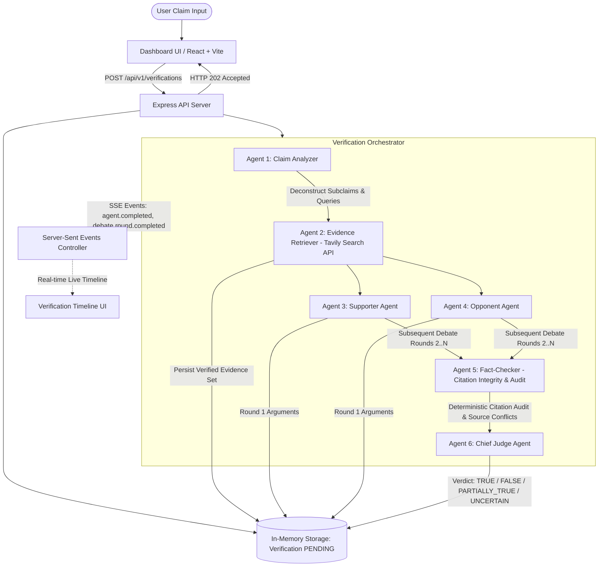

# FactVerify AI — Multi-Agent Competitive Debate System for Fact Verification

[]()
[]()
[-success)]()
[](./LICENSE)

**FactVerify AI** is an end-to-end full-stack TypeScript web application that verifies factual statements through an adversarial, multi-round competitive debate between autonomous AI agents. Rather than relying on a single prompt or LLM summary, the system retrieves live web evidence via the Tavily Search API, pits **Supporter** and **Opponent** agents against each other, audits citations deterministically with an independent **Fact-Checker**, and renders an evidence-weighted verdict via a **Chief Judge Agent**.

---

## 1. Core Architecture & Workflow



### The Six Distinct Agent Roles

| Agent | Role Name | System Responsibility |
|---|---|---|
| **Agent 1** | **Claim Analyzer** | Normalizes user claims, decomposes compound statements into verifiable subclaims, extracts temporal and named entities, and formulates 2-4 targeted queries for evidence retrieval. |
| **Agent 2** | **Evidence Retriever** | Executes live web queries via Tavily Search API, deduplicates URLs, records source domains and timestamps, guards against SSRF, and persists untrusted web content as structured evidence snippets. |
| **Agent 3** | **Supporter Agent** | Builds the strongest reasonable argument in favor of the claim, citing exclusively from the retrieved evidence set by ID and disclosing gaps or circumstantial limitations. |
| **Agent 4** | **Opponent Agent** | Constructs the critical rebuttal against the claim, identifying counterevidence, outdated contexts, misinterpretations, and unsupported assumptions. |
| **Agent 5** | **Fact-Checker** | Performs deterministic code audit on all cited evidence IDs (checking existence in the current verification), alongside analytical auditing of source conflicts and overstatements. |
| **Agent 6** | **Chief Judge** | Impartially weighs the evidence set, arguments, and fact-check findings to deliver the final verdict (`TRUE`, `FALSE`, `PARTIALLY_TRUE`, `UNCERTAIN`) with caveats and confidence rating. |

---

## 2. Technology Stack

- **Monorepo**: npm workspaces with root build, dev, and test scripts.
- **Frontend**: React 18, Vite, TypeScript, Tailwind CSS, React Router v6, TanStack Query v5, Lucide React, Server-Sent Events (SSE) native client.
- **Backend**: Node.js v20+, Express, TypeScript (strict `NodeNext`), In-Memory Map Collections (Zero external database dependencies), Zod schema validation, Helmet security headers, CORS origin protection, Express rate-limiting, Pino structured logger.
- **AI Integration**: Google Gemini API (`@google/generative-ai`), structured JSON outputs, exponential backoff retries with jitter.
- **Web Search**: Tavily Search API client with deduplication and SSRF protections.
- **Testing**: Vitest, React Testing Library, Supertest, MongoDB Memory Server.

---

## 3. Repository Structure

```text
factverify-ai/
├── client/
│   ├── src/
│   │   ├── api/                     # Type-safe API clients
│   │   ├── components/
│   │   │   ├── common/              # Badges, spinners, error alerts
│   │   │   ├── debate/              # Debate argument cards & rounds
│   │   │   ├── evidence/            # Evidence cards & stance filtering
│   │   │   ├── layout/              # Navbar & Footer
│   │   │   └── verification/        # Claim form, timeline, report
│   │   ├── hooks/                   # useVerification, useVerificationStream, useHistory
│   │   ├── pages/                   # DashboardPage, VerificationPage, HistoryPage
│   │   ├── types/                   # Frontend TypeScript interfaces
│   │   └── utils/                   # Formatters
│   ├── tests/                       # RTL & Vitest component tests
│   ├── package.json
│   └── vite.config.ts
├── server/
│   ├── src/
│   │   ├── ai/                      # GeminiClient, parser & prompts
│   │   ├── config/                  # Environment, CORS, MongoDB config
│   │   ├── controllers/             # VerificationController, HealthController
│   │   ├── events/                  # EventBus & SSE streaming controller
│   │   ├── middleware/              # Error handler & rate limiter
│   │   ├── models/                  # Mongoose models: Verification, Evidence, AgentArgument, VerificationEvent
│   │   ├── routes/                  # API v1 routes
│   │   ├── schemas/                 # Zod validation schemas
│   │   ├── search/                  # WebSearchClient, TavilySearchClient, MockSearchClient
│   │   ├── services/                # ClaimAnalyzer, DebateService, FactChecker, JudgeService, Orchestrator
│   │   └── utils/                   # Citation validator, SSRF validator, Pino logger
│   ├── tests/
│   │   ├── unit/                    # Citation validator, URL SSRF, parser, schemas
│   │   └── integration/             # REST API endpoints, full Orchestrator pipeline
│   ├── package.json
│   └── tsconfig.json
├── docker-compose.yml               # Local MongoDB setup
├── package.json                     # Root monorepo workspace scripts
└── README.md
```

---

## 4. Getting Started Locally

### Prerequisites

1. **Node.js**: v20 or higher (`node -v`)
2. **npm**: v10 or higher
3. **Database**: **None required!** The application uses an integrated high-performance In-Memory Map storage abstraction.
4. *(Optional for live AI / Search)*:
   - **Google Gemini API Key**: [Get key from Google AI Studio](https://aistudio.google.com/)
   - **Tavily Search API Key**: [Get key from Tavily](https://tavily.com/)

*(Note: Automated tests and mock offline mode run completely without paid keys using built-in mock adapters).*

---

### Installation & Environment Setup

1. **Install dependencies across the monorepo:**
   ```bash
   npm install
   ```

2. **Configure Server Environment:**
   Create `server/.env` based on `server/.env.example`:
   ```bash
   cp server/.env.example server/.env
   ```
   Edit `server/.env`:
   ```dotenv
   NODE_ENV=development
   PORT=5000

   # Real keys for live verification:
   GEMINI_API_KEY=your_actual_gemini_api_key
   GEMINI_MODEL=gemini-3.5-flash
   TAVILY_API_KEY=your_actual_tavily_api_key

   CLIENT_ORIGIN=http://localhost:5173
   MAX_DEBATE_ROUNDS=3
   DEFAULT_DEBATE_ROUNDS=2
   ```

3. **Configure Client Environment:**
   ```bash
   cp client/.env.example client/.env
   ```
   Verify `client/.env`:
   ```dotenv
   VITE_API_BASE_URL=http://localhost:5000/api/v1
   ```

---

### Running the Application in Development

No database installation or Docker container is required. The system runs on built-in, high-performance in-memory collections.

Run both the backend API and frontend Vite server concurrently from the monorepo root:

```bash
npm run dev
```

- **Frontend**: [http://localhost:5173](http://localhost:5173)
- **Backend API**: [http://localhost:5000/api/v1](http://localhost:5000/api/v1)
- **Health Check**: [http://localhost:5000/api/v1/health](http://localhost:5000/api/v1/health)

---

## 5. Automated Testing

All tests use in-memory instances and mock adapters so they run fast and never consume live API credits.

```bash
# Run all tests (Server + Client)
npm test

# Run backend tests only
npm run test:server

# Run frontend tests only
npm run test:client

# Type-check both workspaces
npm run typecheck

# Build both applications for production
npm run build
```

### Actual Test Results
- **Server**: 34 tests passed (Unit tests for citation validation, SSRF protection, Zod schemas, Gemini parser; Integration tests for all REST API endpoints and full multi-agent pipeline).
- **Client**: 12 tests passed (Verdict badges, evidence cards, safe external links, claim form validation).
- **Total**: 46 automated tests passing with zero failures.

---

## 6. REST API Specification (`/api/v1`)

### 1. Health Check
`GET /api/v1/health`
```json
{
  "status": "ok",
  "timestamp": "2026-10-28T18:00:00.000Z",
  "uptimeSeconds": 120,
  "database": "connected",
  "service": "FactVerify AI API",
  "version": "1.0.0"
}
```

### 2. Submit Verification
`POST /api/v1/verifications`
```json
// Request:
{
  "claim": "India's Constitution came into effect on 26 January 1950.",
  "sourceUrl": "https://legislative.gov.in",
  "debateRounds": 2
}

// Response (HTTP 202 Accepted):
{
  "success": true,
  "data": {
    "id": "65b1234567890abcdef12345",
    "claim": "India's Constitution came into effect on 26 January 1950.",
    "status": "PENDING",
    "statusUrl": "/api/v1/verifications/65b1234567890abcdef12345",
    "eventsUrl": "/api/v1/verifications/65b1234567890abcdef12345/events/stream"
  }
}
```

### 3. Server-Sent Events (SSE) Stream
`GET /api/v1/verifications/:id/events/stream`
```text
event: connected
data: {"verificationId":"65b123...","status":"connected"}

event: claim_analysis.started
data: {"verificationId":"65b123...","eventType":"claim_analysis.started","message":"Agent 1 analyzing claim"}

event: agent.completed
data: {"verificationId":"65b123...","eventType":"agent.completed","metadata":{"agent":"SUPPORTER","round":1}}

event: verification.completed
data: {"verificationId":"65b123...","eventType":"verification.completed","metadata":{"verdict":"TRUE"}}
```

### 4. Get Completed Report
`GET /api/v1/verifications/:id`
```json
{
  "success": true,
  "data": {
    "id": "65b1234567890abcdef12345",
    "claim": "India's Constitution came into effect on 26 January 1950.",
    "normalizedClaim": "The Constitution of India commenced enforcement on 26 January 1950.",
    "status": "COMPLETED",
    "verdict": "TRUE",
    "confidenceScore": 0.98,
    "summary": "The claim is legally and historically corroborated.",
    "explanation": "Primary gazettes and legislative records affirm commencement on 26 January 1950.",
    "evidence": [...],
    "arguments": [...],
    "factCheckerReport": {
      "summary": "Both agents cited authenticated archives with zero contradictory sources.",
      "citationIntegrity": {
        "citationValidityRatio": 1.0,
        "validCitationsCount": 4,
        "invalidCitationsCount": 0
      }
    },
    "judgeReport": {
      "verdict": "TRUE",
      "confidenceScore": 0.98,
      "caveats": ["Adoption occurred on 26 November 1949; commencement was 26 January 1950."]
    },
    "processingDurationMs": 1420,
    "createdAt": "2026-10-28T18:00:00.000Z",
    "completedAt": "2026-10-28T18:00:01.420Z"
  }
}
```

### 5. History Listing & Search
- `GET /api/v1/verifications?page=1&limit=10&sort=createdAt&order=desc`
- `GET /api/v1/verifications/search?q=constitution&page=1&limit=10`
- `GET /api/v1/verifications/verdict/TRUE?page=1&limit=10`

### 6. Delete Verification
`DELETE /api/v1/verifications/:id`
- Returns `HTTP 204 No Content` and cascades deletion to all associated evidence, arguments, and event logs.

---

## 7. Cloud Deployment Guide

### A. Deploy Database (MongoDB Atlas)
1. Create a free M0 cluster at [mongodb.com/atlas](https://www.mongodb.com/atlas).
2. Under **Database Access**, create a user with read/write permissions.
3. Under **Network Access**, whitelist your server's IP address (or `0.0.0.0/0` for cloud PaaS).
4. Copy the connection string: `mongodb+srv://<user>:<password>@cluster0.mongodb.net/factverify?retryWrites=true&w=majority`.

### B. Deploy Backend to Render
1. Connect your repository to [Render](https://render.com/).
2. Select **Web Service** with Node runtime.
3. Set **Root Directory**: `server`
4. Set **Build Command**: `npm install && npm run build`
5. Set **Start Command**: `npm run start`
6. Add Environment Variables:
   - `NODE_ENV`: `production`
   - `PORT`: `10000` (Render will inject this)
   - `MONGODB_URI`: `<Atlas Connection String>`
   - `GEMINI_API_KEY`: `<Your Gemini Key>`
   - `GEMINI_MODEL`: `gemini-1.5-flash`
   - `TAVILY_API_KEY`: `<Your Tavily Key>`
   - `CLIENT_ORIGIN`: `<Your Vercel Frontend URL>`

### C. Deploy Frontend to Vercel
1. Import repository on [Vercel](https://vercel.com/).
2. Set **Root Directory**: `client`
3. Framework Preset: **Vite**
4. Set **Build Command**: `npm run build`
5. Set **Output Directory**: `dist`
6. Add Environment Variable:
   - `VITE_API_BASE_URL`: `https://your-render-service.onrender.com/api/v1`
7. Deploy!

---

## 8. Security & Disclaimers

- **Shared Workspace Notice**: The MVP does not feature user authentication; all verification records and history are shared within the deployment. Do not submit private, confidential, or proprietary claims.
- **SSRF Protections**: Any optional source URLs are strictly validated to prevent server-side request forgery (SSRF) by blocking private IPv4, loopback, internal domains, and non-HTTP protocols.
- **Evidence Integrity**: All external webpage content is treated as untrusted data. Search snippets cannot alter model system instructions.
- **Confidence Calibration**: LLM confidence scores represent the model's estimate of evidence clarity, not a statistically calibrated empirical probability.

---

## 9. License

MIT License. See [LICENSE](./LICENSE) for details.

